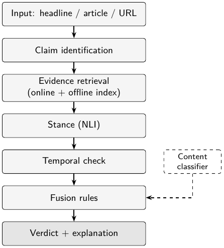

# Beyond Fake or Real: Evidence-Grounded, Explainable Five-Class News Verification with Temporal Context Checking

- **Navishka Sharma** — Dept. of CSE (AI/ML), KIET Group of Institutions, Ghaziabad, Delhi-NCR, India — <navishka.2428cseaiml@kiet.edu>
- **Naitik Kukreja** — Dept. of CSE (AI/ML), KIET Group of Institutions, Ghaziabad, Delhi-NCR, India — <naitik.2428cseaiml99@kiet.edu>
- **Naveen** — Dept. of CSE (AI/ML), KIET Group of Institutions, Ghaziabad, Delhi-NCR, India — <naveen.2428cseaiml15@kiet.edu>
- **Prateek Srivastava** — Dept. of CSE (AI/ML), KIET Group of Institutions, Ghaziabad, Delhi-NCR, India — <prateek.2428cseaiml1@kiet.edu>
- **Nikhil** — Dept. of CSE (AI/ML), KIET Group of Institutions, Ghaziabad, Delhi-NCR, India — <nikhil.2428cseaiml24@kiet.edu>
- **Mukesh Kumar Tripathi** — Dept. of CSE (Artificial Intelligence), Krishna Institute of Engineering & Technology (KIET), Ghaziabad, Delhi-NCR, Uttar Pradesh, India — <mukeshtripathi016@gmail.com>

**Abstract**—Most “fake news” detectors are binary text classifiers that learn how fabricated articles are written, not whether their claims are true; they cannot explain a verdict, describe partly wrong or outdated items, or abstain. We present an open-source pipeline that runs on a student laptop. It extracts check-worthy claims, retrieves evidence from free web sources and an offline index of fact-checked statements, labels the stance of every passage with an NLI cross-encoder, checks dates for old news presented as new, and fuses these signals with transparent rules into one of five verdicts—Real, Fake, Partially True, Misleading or Unverifiable—with a confidence score, dated evidence and an explanation. A fine-tuned DistilBERT style classifier reaches 0.9898 test macro-F1 on WELFake but may only adjust the confidence, because TF-IDF classifiers lose 0.29–0.44 macro-F1 when moved to a disjoint corpus. On 65 held-out fact-checked claims from 2025–26 the full system reaches a five-class macro-F1 of 0.1667 online and 0.0343 offline, far below our 0.55 target, mainly because it abstains too often. We also show that an earlier run leaked each claim’s own fact-check page into the evidence, which inflated macro-F1 from 0.1260 to 0.1854. Code, data splits and claim sets are released.

**Index Terms**—fake news detection, fact verification, evidence retrieval, stance detection, natural language inference, explainable AI, temporal misinformation

> Markdown version of `paper/main.tex`, generated by `make paper-md` (`paper/tex2md.py`). The PDF (`paper/main.pdf`) is the version of record; numbering of sections, tables, figures and references follows it.

## I. Introduction

False stories on Twitter were about 70 % more likely to be retweeted than true ones, and the truth needed roughly six times longer to reach 1,500 people \[1\]. In India, genuine footage of earlier events is routinely re-captioned as “breaking” news; in 125 fact-checked Indian COVID-19 items, nearly half paired text with video and 94 % originated on social platforms \[2\]. Such true material in the wrong time or place is invisible to most detectors.

Most automatic detectors are binary text classifiers that report accuracies above 95 % on benchmark corpora \[3\], \[4\]. They learn *style* and dataset artefacts rather than *facts*—a corpus whose genuine articles all come from one wire service can be separated by boilerplate alone \[5\]; a binary label cannot express a true event with a wrong number or an old video captioned as today’s news; and a classifier cannot say that the evidence is insufficient.

**Problem statement.** Given a headline, article or URL, determine with supporting evidence, dates and a readable explanation whether its central claims are real, fake, partially true, misleading or unverifiable, using only free tools and student hardware.

We move the decision from the classifier to the evidence. Our contributions are:

- **An evidence-grounded five-class verdict scheme with abstention**, reached through a published decision table whose confidence reflects evidence agreement, coverage and source reliability; every output names the rule that fired and the evidence used.

- **A laptop-scale claim-to-verdict pipeline**: claim identification, free-source retrieval with an offline FAISS fallback, NLI stance and a temporal/context check, on CPU.

- **An honestly evaluated content classifier**: a fine-tuned DistilBERT style signal with LIME highlights, a cross-dataset leakage audit, and an end-to-end evaluation that exposes a gold-label leak.

## II. Related Work

**Datasets.** LIAR \[6\] holds 12.8k PolitiFact statements on a six-point scale; its best model reached only about 27 % six-way accuracy. ISOT \[5\] pairs Reuters articles with articles from flagged sites, so every genuine article shares one source. WELFake \[3\] merges four corpora, one of them ISOT, into 72k articles. FakeNewsNet \[7\] adds PolitiFact/GossipCop labels and social context; FEVER \[8\] defines retrieve-then-verify over Wikipedia with *Supports*/*Refutes*/*Not Enough Info*; ClaimBuster \[9\] annotates check-worthiness. Surveys \[10\], \[11\] frame fact-checking as claim detection, evidence retrieval, verdict prediction and justification—the sequence we follow.

**Classifiers.** TF-IDF with a linear SVM reaches about 92 % on ISOT \[5\]; FakeBERT \[4\], built on BERT \[12\], reports 98.9 %. DistilBERT \[13\] keeps about 97 % of BERT’s performance with 40 % fewer parameters, which makes fine-tuning on a 4 GB GPU feasible. Blackledge and Atapour-Abarghouei \[14\] show such models dropping from 0.989–0.997 accuracy in-domain to 0.670–0.697 on another corpus; most other work evaluates in-domain only.

**Verification and explanation.** The FEVER baseline \[8\] scored 31.9 FEVER points and KGAT \[15\] over 70; DeClarE \[16\] verifies claims against web search results with source credibility, close to our online path. Sentence-BERT \[17\] with MiniLM \[18\] makes semantic search over fact-checked statements cheap, and a DeBERTaV3 cross-encoder \[19\] trained on NLI data \[20\] gives CPU stance labels. LIME \[21\] and dEFEND \[22\] explain *models*, not facts. No system we know combines a five-way verdict with abstention, free-source retrieval with an offline fallback, a temporal check and evidence-linked explanations on student hardware (Table V).

## III. Datasets and Preprocessing

After preprocessing, **WELFake** (60,799 articles; 48,639 / 6,080 / 6,080 train/val/test) trains the content classifier and **ISOT** (37,567; 30,053 / 3,757 / 3,757) serves the leakage audit. **LIAR** (12,836 statements, official splits) trains a TRUE / MIXED / FALSE head and, with 1,056 **FakeNewsNet** PolitiFact titles, populates the offline index. A balanced **FEVER** subset (20,000 + 3,000 claims) evaluates stance. LIAR grades map as true/mostly-true $\rightarrow$ Real, half-true $\rightarrow$ Partially True, barely-true $\rightarrow$ Misleading, false/pants-fire $\rightarrow$ Fake; Unverifiable arises only from retrieval failure.

**Live Claims Set.** 95 recent fact-checks (February 2025 to 25 October 2026) from PolitiFact (46), Snopes (31), Lead Stories (9), BOOM (4), Alt News (3) and Full Fact (2), each rating read from the live page and mapped to five classes (Fake 27, Real 21, Partially True 19, Misleading 19, Unverifiable 9). A stratified 30-item dev slice (seed 42) tunes fusion thresholds; 65 items are held out. Second labelling is an AI-assisted blind pass (not a human annotator), accepted by the team: Cohen’s $\kappa=0.9865$ ($n=95$); its one disagreement (LC023) was adjudicated.

**Preprocessing and leakage.** For WELFake and ISOT we strip publisher boilerplate with 26 text and 2 title patterns (datelines, credits, captions, bylines, `[VIDEO]` tags, outlet suffixes) while keeping content words such as “told Reuters”, de-duplicate (SHA-1, then MinHash Jaccard $\geq 0.9$) and split 80/10/10 stratified (seed 42). 37,542 of the 37,567 ISOT articles (99.93 %) occur verbatim in WELFake, so “train on WELFake, test on ISOT” is in-domain; the cross-domain experiment uses **WELFake$\setminus$ISOT** (23,232 rows). A logistic regression on the 26 artefact-pattern counts alone reaches 0.9973 accuracy on raw ISOT but 0.5568 on processed ISOT: raw ISOT is separable by boilerplate, and stripping removes that shortcut.

## IV. Methodology

Fig. 1 shows the pipeline, served by one FastAPI endpoint (`POST /analyze`) in online and offline mode.

*Fig. 1. System pipeline. The content classifier (dashed) feeds fusion only as a confidence adjustment and the single-source tie-break R8.*

**Claims.** spaCy sentences with at least six tokens (no questions or imperatives) are scored $$\begin{gathered}
h(s) = 1.0\,[\mathrm{NE}] + 0.8\,[\mathrm{NUM}] + 0.6\,[\mathrm{REP}] + 0.5\,[i<3] \\
 + 0.4\,[\mathrm{CMP}] - 0.8\,[\mathrm{OPN}] - 0.5\,[\mathrm{HDG}],
\end{gathered}$$ for a named entity, a numeric entity, a reporting verb, a lead position, a comparative, an opinion cue and a hedge, normalised by 3.3. Near-duplicates (MiniLM cosine $>0.85$) are removed and the top $k=5$ kept; a headline is always claim 1. A ClaimBuster-trained classifier \[9\] is not used yet.

**Evidence.** *Online*: DuckDuckGo, Wikipedia and (with a key) Google Fact Check Tools; pages are extracted with trafilatura, dated with htmldate and reduced to the three sentences closest to the claim; fact-checker pages are parsed for their rating; answers are cached in SQLite. *Offline*: `all-MiniLM-L6-v2` \[17\], \[18\] embeddings searched in a FAISS \[23\] `IndexFlatIP` over 13,892 LIAR and FakeNewsNet statements; hits with cosine $<0.55$ are discarded. Each item gets a reliability weight $w_s$: fact-checkers 1.0, wires/official 0.8, Wikipedia 0.6, unknown 0.3, satire 0.

**Stance.** `cross-encoder/nli-deberta-v3-small` \[19\], trained on SNLI \[24\] and MultiNLI \[20\] only and not fine-tuned, maps entailment/contradiction/neutral (premise = evidence) to Supports/Refutes/Neutral with probability $p$. A fact-checker rating becomes the stance ($p=0.95$) only when the claim restates the rated statement. Each item contributes $\sigma(e)=\mathrm{sign}(\mathrm{stance})\cdot p\cdot w_s$.

**Temporal check.** *Old news*: a recency cue (*breaking, today*, …) or an explicit claim date lies $\geq N=6$ months after the median date of the supporting evidence. *Out of context*: place or year entities conflict with two supporting passages. *Headline–body mismatch*: the body refutes the headline with $p\geq 0.7$.

**Fusion.** For claim $i$, $S_i=\sum_e \sigma(e)$ and $E_i$ counts non-neutral items with $w_s\geq 0.5$; the main stance is Supports if $S_1\geq\tau$, Refutes if $S_1\leq-\tau$, else Neutral. Table I is evaluated top to bottom. $\tau=0.8$ and $m=3$ were chosen by a grid search on the 30 dev claims and 15 temporal controls, raising dev macro-F1 from 0.0857 to 0.1165 (one claim)—a sanity check, not an optimum. Confidence is $\mathrm{clip}(0.5a+0.3c+0.2q+\delta,\,0.05,\,0.98)$ with agreement $a=|S_1|/\sum_e p_e w_e$, coverage $c=\min(E_1,4)/4$, mean reliability $q$, and $\delta=\pm0.10$ when the classifier’s $p_\mathrm{fake}$ agrees/disagrees with a Fake/Real verdict; for Unverifiable, $1-\max(a,0.2)$.

**Table I.** Fusion rules; first match wins. “Imp.” = another claim with score $\geq 0.6$.

| Rule | Condition                                                                                                                           | Verdict |
|:-----|:------------------------------------------------------------------------------------------------------------------------------------|:--------|
| LANG | input is not English                                                                                                                | Unv.    |
| R0   | input domain on the satire / hoax list                                                                                              | Fake    |
| R1   | no evidence, all evidence neutral, or $E_1=0$                                                                                       | Unv.    |
| R2   | Tier-1 fact-check rated false, stance Refutes, cosine to main claim $\geq 0.75$                                                     | Fake    |
| R3   | main Refutes and $E_1\geq 3$                                                                                                        | Fake    |
| R4   | main Supports and a temporal/context flag                                                                                           | Misl.   |
| R5   | main Supports, an imp. claim has $S_i\leq-\tau$, $E_i\geq 3$                                                                        | Part.   |
| R6   | main Neutral, imp. claims split (one $S_i\geq\tau$, one $S_i\leq-\tau$, each $E_i\geq 3$)                                           | Part.   |
| R7   | main Supports and $E_1\geq 3$                                                                                                       | Real    |
| R8   | main non-neutral and $E_1=1$: Fake if Refutes and $p_\mathrm{fake}\geq 0.85$; Real if Supports and $p_\mathrm{fake}\leq 0.15$; else | Unv.    |
| R9   | anything else                                                                                                                       | Unv.    |

**Content classifiers.** TF-IDF $n$-grams with Naive Bayes, logistic regression and a linear SVM (5-fold grid search), and `distilbert-base-uncased` \[13\], \[25\] fine-tuned on `title [SEP] text`; a second DistilBERT head is trained on LIAR statements (no speaker or party, which are label proxies). All training ran on one RTX 2050 (4 GB).

## V. Results

### A. Content Classifiers

On WELFake (Table II) the tuned SVM reaches 0.9481 macro-F1 and DistilBERT **0.9898** (accuracy 0.9900, ROC-AUC 0.9995), meeting objective O1 ($\geq 0.95$); ISOT is in-domain here. In a sweep on a 20k-row subset the three learning rates at length 256 lay within 0.0008 validation macro-F1 (0.9863–0.9871); the full-data run with $5\times10^{-5}$ took 31.6 minutes. The length-512 arm was not run. Of 6,080 test articles 61 are misclassified (47 missed fakes, 14 false alarms): 27 by truncation, 17 by style overlap, 6 opinion, 5 misleading source cues, 4 short texts, 2 republished wire copy—errors of style and length, not of fact.

**Table II.** Content classifiers, test split (in-domain). Val = validation macro-F1; DB = DistilBERT (full train, max_len 256).

| Data    | Model | Val    | Acc    | P      | R      | **F1**     | AUC    |
|:--------|:------|:-------|:-------|:-------|:-------|:-----------|:-------|
| WELFake | NB    | 0.8728 | 0.8771 | 0.8744 | 0.8782 | **0.8758** | 0.9443 |
|         | LR    | 0.9455 | 0.9462 | 0.9457 | 0.9449 | **0.9453** | 0.9875 |
|         | SVM   | 0.9495 | 0.9490 | 0.9485 | 0.9478 | **0.9481** | 0.9884 |
|         | DB    | 0.9930 | 0.9900 | 0.9905 | 0.9891 | **0.9898** | 0.9995 |
| ISOT    | NB    | 0.9550 | 0.9470 | 0.9458 | 0.9472 | **0.9464** | 0.9865 |
|         | LR    | 0.9892 | 0.9848 | 0.9854 | 0.9839 | **0.9846** | 0.9986 |
|         | SVM   | 0.9900 | 0.9878 | 0.9882 | 0.9870 | **0.9876** | 0.9990 |
|         | DB    | –      | 0.9992 | 0.9992 | 0.9992 | **0.9992** | 1.0000 |

**Table III.** Cross-domain macro-F1, test splits (rows = train). Proc. = artefacts stripped; raw = kept.

|       |               |               |        |               |        |
|:------|:--------------|:--------------|:-------|:--------------|:-------|
|       |               | Processed     |        | Raw           |        |
| Model | Train         | W$\setminus$I | ISOT   | W$\setminus$I | ISOT   |
| LR    | W$\setminus$I | 0.9583        | 0.6638 | 0.9645        | 0.7616 |
|       | ISOT          | 0.5502        | 0.9846 | 0.5663        | 0.9933 |
| SVM   | W$\setminus$I | 0.9601        | 0.6611 | 0.9676        | 0.7611 |
|       | ISOT          | 0.5480        | 0.9876 | 0.5601        | 0.9949 |

**Cross-domain.** Leaving the training domain costs 0.29–0.30 macro-F1 from WELFake$\setminus$ISOT to ISOT and 0.43–0.44 in reverse (Table III); with artefacts kept transfer looks better (0.7616 vs. 0.6638 for LR), i.e. part of what “transfers” is boilerplate. DistilBERT was not run cross-domain. This drop is why evidence, not the classifier, decides the verdict.

**LIAR and stance.** The LIAR head reaches 0.4669 three-way test accuracy (macro-F1 0.4667; majority 0.3749); its six-way twin’s 0.2689 matches Wang’s text-only CNN (0.270) \[6\]. On 3,000 balanced FEVER dev pairs the zero-shot cross-encoder reaches 0.7267 accuracy (macro-F1 0.7121), **missing O4** ($\geq 0.85$): Supports/Refutes pairs score 0.8790, but 479 of 1,000 NEI pairs are predicted Refutes. Rule R3, which needs three reliable refuting sources, damps this error.

### B. End-to-End Evaluation on Live Claims

Each held-out claim is sent through `POST /analyze` as a dated headline (DuckDuckGo, Wikipedia and the offline index; no Google Fact Check key). Online the system reaches 0.2000 accuracy and 0.1667 macro-F1, offline—where the index has a hit for only 36.9 % of claims—0.0343 (Table IV). O6 (macro-F1 $\geq 0.55$, Unverifiable precision $\geq 0.70$) is **not met**; O3 (an online passage for $\geq 85$ % of claims) is met with 100 %. 53 of 65 answers are Unverifiable and Partially True/Misleading are never predicted, but committed Real and Fake answers have precision 0.6667. R1 (29) and R9 (18) fired most often. The classifier alone has higher accuracy (0.2462) but lower macro-F1 (0.1328) because it never abstains; the temporal check changes no verdict.

**Table IV.** End-to-end results on the 65 held-out Live Claims (v2 = with leakage guard; text-only = 58 claims not about an image or video), and per-class results of v2 online.

| Run                           | Acc        | Macro-F1   | Unv. P |
|:------------------------------|:-----------|:-----------|:-------|
| **v2 online**                 | **0.2000** | **0.1667** | 0.0943 |
| v2 online, text-only          | 0.1724     | 0.1463     | 0.0816 |
| v2 offline                    | 0.0923     | 0.0343     | 0.0938 |
| classifier only (ablation)    | 0.2462     | 0.1328     | –      |
| v1 online, leaky (no guard)   | 0.2308     | 0.1854     | 0.0789 |
| v1, own page removed post hoc | 0.1538     | 0.1260     | 0.0909 |
| Target (O6)                   | –          | 0.55       | 0.70   |

|              | Real   | Fake   | Part.  | Misl.  | Unv.   |
|:-------------|:-------|:-------|:-------|:-------|:-------|
| P            | 0.6667 | 0.6667 | 0.0000 | 0.0000 | 0.0943 |
| R            | 0.1429 | 0.3158 | 0.0000 | 0.0000 | 0.8333 |
| F1           | 0.2353 | 0.4286 | 0.0000 | 0.0000 | 0.1695 |
| Gold / pred. | 14 / 3 | 19 / 9 | 13 / 0 | 13 / 0 | 6 / 53 |

**A leakage finding.** Our first run (v1, macro-F1 0.1854) often retrieved the claim’s *own* fact-check page—the source of its gold label—as evidence, for 34 of the 65 claims. Removing those items and re-fusing gives 0.1260, the honest v1 baseline. An evaluation-only guard now drops evidence whose URL equals the claim’s fact-check URL (35 of 65 in v2). In deployment finding a fact-check is intended; in evaluation it turns the task into label lookup.

**Temporal set, latency, robustness.** On 30 verified fact-checks (15 recirculated old items, 15 controls) the old-news flag never fired: 50 % correct, so O5 ($\geq 80$ %) is **not met**; 7 missed items had no dated supporting evidence and 5 had a gap below $N$. Median CPU time per claim is 40 ms offline, 2,890 ms online with a warm cache and 11,032 ms uncached; peak memory is 2,373.8 MB. A CPU-only Docker image (about 3.1 GB) with a web interface, evidence cards and LIME highlights answered all five gallery examples offline. Sixteen malformed or adversarial inputs produced no server error.

**Cases.** *“WHO declared that 5G towers spread COVID-19”* is Fake by R3 (four reliable refuting sources). The true *Chandrayaan-3* landing headline ends Unverifiable while DistilBERT gives $P(\text{fake})=0.9797$—a classifier-first system would call it fake. In LC003 the NLI model labelled a near-verbatim restatement neutral (R1).

## VI. Discussion

**Table V.** Comparison with existing systems (E/T/A = evidence-grounded / date check / abstains). Published results use other data and splits.

| System             | E/T/A   | Published                      | Ours (closest)                  |
|:-------------------|:--------|:-------------------------------|:--------------------------------|
| PolitiFact, Snopes | ✓✓✓     | gold standard                  | 13 of 65 ratings matched        |
| LIAR CNN \[6\]     | –/–/–   | 0.270 acc. (6-way)             | twin 0.2689                     |
| ISOT SVM \[5\]     | –/–/–   | $\approx$92 % acc.     | 0.9876 F1; 0.5480 cross         |
| WELFake \[3\]      | –/–/–   | 96.7 % acc.                    | DistilBERT 0.9900 acc.          |
| FakeBERT \[4\]     | –/–/–   | 98.9 % (Kaggle)                | not evaluated                   |
| DistilBERT \[14\]  | –/–/–   | 0.989 $\rightarrow$ 0.670 acc. | SVM 0.9601 $\rightarrow$ 0.6611 |
| FEVER \[8\]        | ✓/–/NEI | 31.9 FEVER score               | stance 0.7267 (zero-shot)       |
| KGAT \[15\]        | ✓/–/NEI | $>$70 FEVER score      | no FEVER score                  |
| DeClarE \[16\]     | ✓/–/–   | binary, no abstention          | five classes                    |
| dEFEND \[22\]      | –/–/–   | explains model                 | explains evidence               |
| **This work**      | ✓✓✓     | –                              | macro-F1 0.1667                 |

**Comparison.** Table V places the system among existing ones. Manual fact-checkers are far more accurate; style classifiers score higher on their own benchmarks but, like ours, lose most of that across corpora; FEVER verifiers are stronger on closed Wikipedia claims; and a fact-check search tool such as Google Fact Check Explorer beats our NLI when a check exists. What we add is a verdict when no fact-check exists (R3/R7 from ordinary news), a date check, and honest abstention with the rule and evidence behind every verdict—although abstention is currently too frequent (precision 0.0943).

**Limitations.** End-to-end macro-F1 is 0.1667 against 0.55; the evaluation set is small (65 held-out claims, an AI-assisted rather than human second labeller, thresholds tuned on 30); results depend on an unofficial DuckDuckGo interface and the offline index covers 36.9 % of recent claims; the zero-shot stance model confuses NEI with Refutes; the temporal check never fired; input is English text only; DistilBERT was not run at length 512 or cross-domain; and the leakage guard matches URLs only, so it is a lower bound.

## VII. Conclusion and Future Work

We presented an evidence-grounded, explainable pipeline that turns a headline, article or URL into one of five verdicts with free tools on a student laptop, letting the content classifier only adjust confidence. DistilBERT reaches 0.9898 macro-F1 in-domain, but classical classifiers fall to 0.6611 and 0.5480 across disjoint corpora. On 65 recent fact-checked claims the system reaches 0.1667 macro-F1 online, well below target, and our first evaluation over-stated it (0.1854 vs. 0.1260) by retrieving the gold fact-check page—we recommend such a guard for any evaluation drawing claims from fact-checkers. Future work: fine-tune stance on NEI pairs, use the Google Fact Check API, improve dated retrieval for the temporal check, learn fusion thresholds from a larger double-labelled set, complete the DistilBERT runs, and add Hindi/Hinglish and OCR input.

## Acknowledgment

The authors thank their project guide and the Department of CSE (AI/ML), KIET Group of Institutions, for guidance and facilities.

## References

1. S. Vosoughi, D. Roy, and S. Aral, “The spread of true and false news online,” *Science*, vol. 359, no. 6380, pp. 1146–1151, 2018.
2. M. S. Al-Zaman, “COVID-19-related social media fake news in India,” *Journalism and Media*, vol. 2, no. 1, pp. 100–114, 2021.
3. P. K. Verma, P. Agrawal, I. Amorim, and R. Prodan, “WELFake: Word embedding over linguistic features for fake news detection,” *IEEE Transactions on Computational Social Systems*, vol. 8, no. 4, pp. 881–893, 2021.
4. R. K. Kaliyar, A. Goswami, and P. Narang, “FakeBERT: Fake news detection in social media with a BERT-based deep learning approach,” *Multimedia Tools and Applications*, vol. 80, pp. 11 765–11 788, 2021.
5. H. Ahmed, I. Traore, and S. Saad, “Detection of online fake news using N-gram analysis and machine learning techniques,” in *Intelligent, Secure, and Dependable Systems in Distributed and Cloud Environments (ISDDC 2017)*, ser. Lecture Notes in Computer Science, vol. 10618. Springer, 2017, pp. 127–138.
6. W. Y. Wang, ““Liar, Liar Pants on Fire”: A new benchmark dataset for fake news detection,” in *Proceedings of the 55th Annual Meeting of the Association for Computational Linguistics (Volume 2: Short Papers)*. Vancouver, Canada: Association for Computational Linguistics, 2017, pp. 422–426.
7. K. Shu, D. Mahudeswaran, S. Wang, D. Lee, and H. Liu, “FakeNewsNet: A data repository with news content, social context, and spatiotemporal information for studying fake news on social media,” *Big Data*, vol. 8, no. 3, pp. 171–188, 2020.
8. J. Thorne, A. Vlachos, C. Christodoulopoulos, and A. Mittal, “FEVER: A large-scale dataset for fact extraction and VERification,” in *Proceedings of the 2018 Conference of the North American Chapter of the Association for Computational Linguistics: Human Language Technologies, Volume 1 (Long Papers)*. New Orleans, Louisiana: Association for Computational Linguistics, 2018, pp. 809–819.
9. F. Arslan, N. Hassan, C. Li, and M. Tremayne, “A benchmark dataset of check-worthy factual claims,” in *Proceedings of the Fourteenth International AAAI Conference on Web and Social Media (ICWSM)*, vol. 14, 2020, pp. 821–829.
10. X. Zhou and R. Zafarani, “A survey of fake news: Fundamental theories, detection methods, and opportunities,” *ACM Computing Surveys*, vol. 53, no. 5, pp. 109:1–109:40, 2020.
11. Z. Guo, M. Schlichtkrull, and A. Vlachos, “A survey on automated fact-checking,” *Transactions of the Association for Computational Linguistics*, vol. 10, pp. 178–206, 2022.
12. J. Devlin, M.-W. Chang, K. Lee, and K. Toutanova, “BERT: Pre-training of deep bidirectional transformers for language understanding,” in *Proceedings of the 2019 Conference of the North American Chapter of the Association for Computational Linguistics: Human Language Technologies, Volume 1 (Long and Short Papers)*. Minneapolis, Minnesota: Association for Computational Linguistics, 2019, pp. 4171–4186.
13. V. Sanh, L. Debut, J. Chaumond, and T. Wolf, “DistilBERT, a distilled version of BERT: smaller, faster, cheaper and lighter,” *arXiv preprint arXiv:1910.01108*, 2019, presented at the 5th Workshop on Energy Efficient Machine Learning and Cognitive Computing (NeurIPS 2019).
14. C. Blackledge and A. Atapour-Abarghouei, “Transforming fake news: Robust generalisable news classification using transformers,” 2021. \[Online\]. Available: <https://arxiv.org/abs/2109.09796>
15. Z. Liu, C. Xiong, M. Sun, and Z. Liu, “Fine-grained fact verification with kernel graph attention network,” in *Proceedings of the 58th Annual Meeting of the Association for Computational Linguistics*. Association for Computational Linguistics, 2020, pp. 7342–7351.
16. K. Popat, S. Mukherjee, A. Yates, and G. Weikum, “DeClarE: Debunking fake news and false claims using evidence-aware deep learning,” in *Proceedings of the 2018 Conference on Empirical Methods in Natural Language Processing*. Brussels, Belgium: Association for Computational Linguistics, 2018, pp. 22–32.
17. N. Reimers and I. Gurevych, “Sentence-BERT: Sentence embeddings using Siamese BERT-networks,” in *Proceedings of the 2019 Conference on Empirical Methods in Natural Language Processing and the 9th International Joint Conference on Natural Language Processing (EMNLP-IJCNLP)*. Hong Kong, China: Association for Computational Linguistics, 2019, pp. 3982–3992.
18. W. Wang, F. Wei, L. Dong, H. Bao, N. Yang, and M. Zhou, “MiniLM: Deep self-attention distillation for task-agnostic compression of pre-trained transformers,” in *Advances in Neural Information Processing Systems*, vol. 33, 2020, pp. 5776–5788.
19. P. He, J. Gao, and W. Chen, “DeBERTaV3: Improving DeBERTa using ELECTRA-style pre-training with gradient-disentangled embedding sharing,” in *The Eleventh International Conference on Learning Representations (ICLR)*, 2023.
20. A. Williams, N. Nangia, and S. Bowman, “A broad-coverage challenge corpus for sentence understanding through inference,” in *Proceedings of the 2018 Conference of the North American Chapter of the Association for Computational Linguistics: Human Language Technologies, Volume 1 (Long Papers)*. New Orleans, Louisiana: Association for Computational Linguistics, 2018, pp. 1112–1122.
21. M. T. Ribeiro, S. Singh, and C. Guestrin, ““Why should I trust you?”: Explaining the predictions of any classifier,” in *Proceedings of the 22nd ACM SIGKDD International Conference on Knowledge Discovery and Data Mining*. San Francisco, CA, USA: ACM, 2016, pp. 1135–1144.
22. K. Shu, L. Cui, S. Wang, D. Lee, and H. Liu, “dEFEND: Explainable fake news detection,” in *Proceedings of the 25th ACM SIGKDD International Conference on Knowledge Discovery & Data Mining*. Anchorage, AK, USA: ACM, 2019, pp. 395–405.
23. J. Johnson, M. Douze, and H. Jégou, “Billion-scale similarity search with GPUs,” *IEEE Transactions on Big Data*, vol. 7, no. 3, pp. 535–547, 2021.
24. S. R. Bowman, G. Angeli, C. Potts, and C. D. Manning, “A large annotated corpus for learning natural language inference,” in *Proceedings of the 2015 Conference on Empirical Methods in Natural Language Processing*. Lisbon, Portugal: Association for Computational Linguistics, 2015, pp. 632–642.
25. T. Wolf, L. Debut, V. Sanh, J. Chaumond, C. Delangue, A. Moi, P. Cistac, T. Rault, R. Louf, M. Funtowicz, J. Davison, S. Shleifer, P. von Platen, C. Ma, Y. Jernite, J. Plu, C. Xu, T. Le Scao, S. Gugger, M. Drame, Q. Lhoest, and A. M. Rush, “Transformers: State-of-the-art natural language processing,” in *Proceedings of the 2020 Conference on Empirical Methods in Natural Language Processing: System Demonstrations*. Association for Computational Linguistics, 2020, pp. 38–45.
